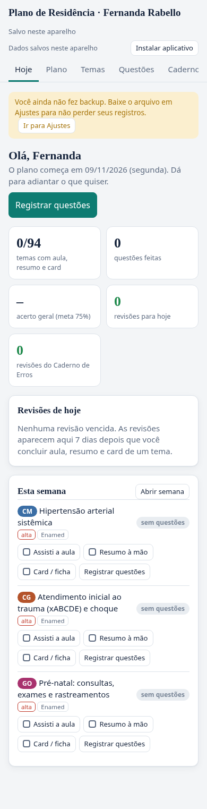
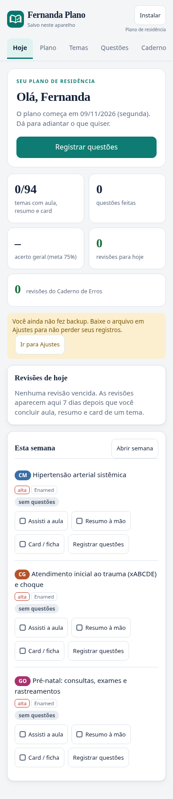

# Auditoria de design do PWA — 7 de novembro de 2026

## Identidade e ícone


O novo símbolo combina um livro aberto e uma marca de conclusão: estudo e progresso. Mantém o verde do aplicativo, com traços claros e legíveis em tamanho pequeno. Substitui a cruz médica genérica e aparece também no cabeçalho.

Foram preparados PNGs opacos de 192 e 512 px, um ícone maskable de 512 px, apple-touch-icon de 180 px e favicon de 32 px. O símbolo essencial fica dentro do círculo de segurança do Android: raio máximo medido de 39,1% da largura, frente ao limite de 40%. A imagem não tem cantos arredondados embutidos; o sistema pode aplicar seu próprio recorte. Os ícones usam paleta reduzida para limitar o download.

O `id`, o `start_url` e o `scope` do manifesto permanecem `./`. A atualização visual não cria outro aplicativo nem altera o endereço dos dados.

## Achados e correções

| Problema observado | Correção |
| --- | --- |
| Texto dos avisos e etiquetas sem contraste suficiente; etiquetas de áreas com texto branco sobre cores claras no tema escuro | Tons de aviso e estado ajustados; texto das áreas se adapta ao tema |
| Botões pequenos, incluindo marcações e ações secundárias | Botões com pelo menos 44 × 44 px e espaçamento maior; campos com altura mínima de 44 px |
| Abas sem navegação por setas e sem associação ao painel | Setas, Home e End; uma única aba na sequência de Tab; aba ativa trazida para a área visível; painel nomeado pela aba |
| Temas e semanas eram blocos clicáveis sem semântica de botão | Botões nativos, com ativação por Enter e Espaço |
| Diálogos sem controle de foco e com fundo ainda interativo | Nome acessível, foco no diálogo, ciclo de Tab/Shift+Tab, fundo inerte, rolagem do fundo bloqueada e retorno de foco ao fechar |
| Redesenhar a tela removia o foco da marcação acionada | Restauração do foco no controle correspondente após atualizar a tela |
| Tabela horizontal sem acesso direto pelo teclado | Região nomeada e focável |
| Campos dependiam de texto visual ou placeholder para identificação | Nomes acessíveis explícitos para quantidades, acertos e backup |
| Cabeçalho repetia mensagens de gravação e instalação ocupava uma linha inteira | Marca com ícone e título, estado de gravação em uma linha e instalação compacta; o botão é ocultado no modo instalado |
| Aviso de backup aparecia antes da ação principal e dos indicadores | Saudação e registro de questões em destaque; indicadores e aviso em sequência |
| Layout do PWA sem tratamento explícito das áreas seguras | Insets de tela aplicados ao cabeçalho, conteúdo, diálogos e notificações; campos de 16 px no celular para reduzir zoom automático no iOS |

As nove seções continuam disponíveis. A rolagem horizontal das abas é intencional no celular; as tabelas também mantêm sua própria rolagem. A página inteira não deve transbordar.

## Validação e resultados

A avaliação inicial percorreu as nove seções em 320, 390, 768 e 1440 px, nos temas claro e escuro. O axe apontou falhas de contraste e de foco nas tabelas. Na tela Hoje de 390 px, havia 24 botões abaixo de 44 px e o cabeçalho media aproximadamente 155 px de altura.

Depois das correções:

- 92 estados verificados no Chromium: 72 combinações de seção/largura/tema, 18 estados adicionais com exemplos de progresso e simulados, e dois diálogos de registro de questões.
- Nenhuma página com transbordamento horizontal, abas sobrepostas ou erros de JavaScript nas combinações avaliadas.
- Nenhum botão abaixo de 44 × 44 px nas telas verificadas.
- Nenhuma violação detectada pelo axe nos critérios automatizados WCAG 2 A/AA e 2.1 AA avaliados em 390 px, nos dois temas, com e sem exemplos de progresso, e nos diálogos.
- Verificação real de teclado: Home/End nas abas, aba ativa visível, tabulação única, foco no diálogo, ciclo Tab/Shift+Tab, Escape, retorno ao acionador, marcações sem perda de foco e abertura de tema por Enter.
- Na tela Hoje de 390 px, o cabeçalho passou para aproximadamente 137 px.
- 11 testes automatizados da aplicação, incluindo persistência, recuperação de dados, manifesto/PNGs, navegação, foco, servidor e cache offline.
- Build de produção e `npm audit` sem vulnerabilidades conhecidas.

## Comparação visual

| Antes no celular | Depois no celular |
| --- | --- |
|  |  |

[Versão escura no celular](design/depois-escuro.png) · [Versão desktop](design/depois-desktop.png)

## Como reproduzir

Na pasta `app`:

```sh
npm ci
npm run build
npm test
npx playwright install chromium
npm run test:design
```

Para usar Chromium já instalado, execute `CHROMIUM_PATH=/usr/bin/chromium npm run test:design`. O teste inicia um servidor local em porta temporária, usa perfis isolados e não acessa dados reais. `DESIGN_SCREENSHOTS=/caminho/gravavel` permite salvar as capturas da tela Hoje.

A rotina `.github/workflows/design.yml` repete o build, os testes da aplicação e a auditoria de navegador nas pull requests e na `main`.

## Limites

Os resultados automáticos não certificam conformidade integral com WCAG. Os ensaios usam Chromium de desktop em larguras diferentes; não substituem testes em iPhone/Android físicos, leitores de tela, teclado virtual ou instalação real do PWA. Os estados de exemplo incluem temas, questões e simulados, mas não todos os registros possíveis do Caderno de Erros e da biblioteca. O recorte do ícone foi verificado geometricamente; a propagação de uma troca de ícone em atalhos já instalados depende do sistema e do navegador.
